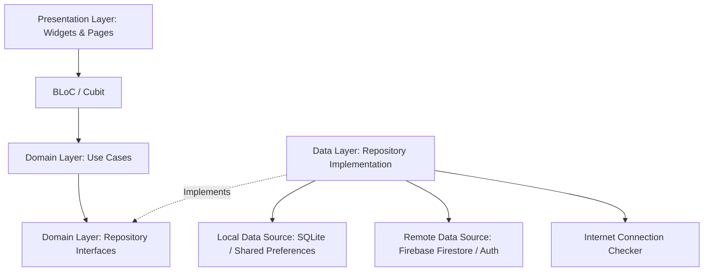

# 🌟 نظام إدارة رياض الأطفال والبراعم | Al-Baraem Kindergarten Management System

<div align="center">


<br/>

**منظومة برمجية متكاملة ومتقدمة لإدارة شؤون رياض الأطفال ومراكز الطفولة المبكرة**  
*حل رقمي شامل يعتمد على معمارية Clean Architecture، يدعم العمل بدون إنترنت (Offline-First)، ويجمع بين إدارة الكادر التعليمي، تقييمات الطلاب، والتحضير الذكي عبر رموز الـ QR.*

[نظرة عامة](#-نظرة-عامة-عن-المشروع) •
[المميزات الرئيسية](#-المميزات-الرئيسية) •
[الهندسة البرمجية](#-الهندسة-البرمجية-وأنماط-التصميم) •
[التقنيات المستخدمة](#-التقنيات-وحزم-العمل-tech-stack) •
[هيكلية المشروع](#-الهيكل-التنظيمي-للمشروع-project-structure) •
[دليل التثبيت والتشغيل](#-دليل-التثبيت-والتشغيل)

---

</div>

## 📖 نظرة عامة عن المشروع

**نظام البراعم (Al-Baraem)** هو تطبيق إداري وتعليمي حديث تم تطويره خصيصاً ليلبي متطلبات رياض الأطفال والمدارس الابتدائية المبكرة. تم تصميم المنظومة لتسهيل التواصل بين الإدارة والمعلمات وأولياء الأمور، وأتمتة العمليات اليومية مثل رصد الحضور والانصراف، إدارة ملفات الطلاب ومتابعة تطورهم الأكاديمي والتقييمي، مع توفير لوحات تحكم متخصصة لكل مستخدم بحسب دوره وصلاحياته.

يتميز التطبيق بتطبيق صارم لأفضل الممارسات الهندسية في بناء تطبيقات الهاتف المحمول، وفي مقدمتها:
- تطبيق مبادئ **Clean Architecture** و **SOLID Principles**.
- نمط **Offline-First** الكامل المعتمد على التخزين المحلي والمزامنة التلقائية مع السحابة.
- بنية أمان وتحكم في الوصول تعتمد على الأدوار (**Role-Based Access Control - RBAC**).
- واجهة مستخدم عربية أصيلة بالكامل (RTL-First) بخطوط وهوية بصرية مخصصة.

---

## ✨ المميزات الرئيسية

### 1. 🛡️ نظام المصادقة والصلاحيات متعدد المستويات (RBAC)
- **المصادقة الآمنة:** دعم تسجيل الدخول بالبريد الإلكتروني وكلمة المرور وحساب Google (`Google Sign-In`) مع معالجة إكمال الملف الشخصي للمستخدمين الجدد.
- **توجيه ديناميكي حسب الصلاحية:** توجيه فوري للمستخدم بناءً على رتبته عبر `GoRouter` وبوابات فحص الأمان (`AuthGate`):
  - 👑 **المشرف العام (Super Admin):** إدارة حسابات النظام، تفعيل/تعطيل المستخدمين، وتعديل الرتب والإشراف الكامل.
  - 🏫 **المديرة (Manager):** إحصائيات عامة، متابعة حضور الكادر التعليمي والطلاب، واستعراض تقارير الإنجاز.
  - 👩‍🏫 **المعلمة (Teacher):** تحضير الحضور بمسح الـ QR، رصد درجات المواد الدراسية، وإدارة صفوف الأطفال.
  - 👨‍👩‍👦 **ولي الأمر (Parent):** متابعة سجل حضور وغياب الطفل وشهادات التقييم الدوري.

---

### 2. 👶 إدارة شؤون الطلاب والمراحل الدراسية
- **هيكلة المراحل التعليمية:** دعم مراحل الروضة الثلاث:
  - `KG1` — التمهيدي
  - `KG2` — الأول
  - `KG3` — الثاني
- **سجل الطالب الشامل:** بيانات الهوية، تاريخ الميلاد، معلومات ولي الأمر، الحساب التلقائي للعمر ومؤشرات الأداء.
- **نظام التقييم والدرجات التراكمي:**
  - تقييم شامل مقسم حسب الفصول الدراسية (`Semester 1` / `Semester 2`).
  - رصد عناصر التقييم المختلفة (اختبارات، أنشطة، مشاركة، واجبات).
  - احتساب المعدلات الفصلية والسنوية والنسب المئوية بشكل آلي.
  - منطق الترقية التلقائية إلى الصف الأعلى أو تخرج الطالب.

---

### 3. 👩‍🏫 إدارة الكادر التعليمي
- **الملف الوظيفي والأكاديمي:** أرشفة المؤهلات العلمية، سنة التخرج، التخصص، الحالة الاجتماعية، وبيانات التواصل.
- **سجل النشاط اليومي:** متابعة تواجد المعلمات، توزيع الجداول والصفوف، وتقارير الحضور الدورية.

---

### 4. ⚡ نظام الحضور والغياب الذكي عبر الـ QR
- **توليد رمز حضور ديناميكي:** إمكانية إصدار رمز QR يومي أو لفترة زمنية محددة مع معرف المدرسة وكود التحقق.
- **الطباعة والتصدير الفوري:** إمكانية طباعة بطاقات ورموز الحضور بصيغة **PDF** عالية الجودة ومجهزة بالخط العربي المعتمد (`Somar`) للتعليق عند بوابات الدخول.
- **قارئ QR مدمج عالي الدقة:** كاميرا مدمجة مدعومة بحزمة `mobile_scanner` لقراءة سريعة دون تأخير، مع تأكيد صوتي واهتزازي وتفادي التكرار.

---

### 5. 🔄 العمل بدون إنترنت والمزامنة الذكية (Offline-First)
- **قاعدة بيانات محلية سريعة:** استخدام **SQLite** لتخزين بيانات الطلاب والمستخدمين وسجلات الحضور محلياً.
- **تحقق مستمر من الاتصال:** تتبع حالة الشبكة باستخدام `InternetConnectionChecker`.
- **المزامنة في الخلفية:** مزامنة العمليات المعلقة مع **Firebase Cloud Firestore** فور استعادة الاتصال دون مقاطعة تجربة المستخدم.

---

## 🏗️ الهندسة البرمجية وأنماط التصميم

تم بناء المشروع باتباع أرقى معايير تطوير البرمجيات لضمان القابلية للتوسع (Scalability)، وسهولة الصيانة (Maintainability)، وقابلية الاختبار (Testability):



### المبادئ المطبقة:
1. **Clean Architecture:**
   - **Domain Layer:** يحتوي على الـ Entities و UseCases وواجهات المستودعات (عناصر نقية خالية من أي مكتبات خارجية).
   - **Data Layer:** يحتوي على النماذج (Models)، ومصادر البيانات (Data Sources - Remote/Local)، وتطبيق المستودعات (Repository Implementations).
   - **Presentation Layer:** يحتوي على واجهات المستخدم (Screens & Widgets) وإدارة الحالة (Cubits/States).
2. **BLoC Pattern (flutter_bloc):** عزل تام لمنطق الأعمال (Business Logic) عن طبقة العرض والواجهات.
3. **Functional Error Handling (Dartz):** الاعتماد على نمط `Either<Failure, Type>` لمنع الاستثناءات غير المتوقعة (Exceptions) وتوفير معالجة أخطاء معيارية وقابلة للتتبع.
4. **Dependency Injection (GetIt):** حقن التبعيات بنمط Service Locator لتسهيل إدارة دورة حياة الكائنات وفك الارتباط التام (Decoupling).
5. **Declarative Navigation (GoRouter):** نظام مسارات موحد يدعم الـ Deep Linking وحماية المسارات (Route Guards).

---

## 🛠️ التقنيات وحزم العمل (Tech Stack)

| التقنية / الحزمة | الاستخدام والدور الأساسي |
| :--- | :--- |
| **Flutter & Dart** | إطار العمل الرئيسي لبناء التطبيق بأعلى أداء لنظامي Android و iOS |
| **flutter_bloc & equatable** | إدارة الحالة (State Management) المتقدمة وتتبع تغييرات البيانات |
| **Firebase Auth & Google Sign-In** | إدارة مصادقة المستخدمين وجلسات الدخول السحابية |
| **Cloud Firestore** | قاعدة البيانات السحابية المركزية لتخزين البيانات والمزامنة الفورية |
| **sqflite & path_provider** | قاعدة البيانات المحلية للعمل بدون إنترنت بتصميم Offline-First |
| **get_it** | حقن التبعيات ومزود الخدمات (Dependency Injection / Service Locator) |
| **dartz** | البرمجة الوظيفية والتعامل مع الأخطاء عبر `Either<Failure, T>` |
| **go_router** | إدارة التوجيه والمسارات بشكل تصريحي وحماية الصفحات حسب الصلاحية |
| **mobile_scanner** | فحص رموز الـ QR بالكاميرا بسرعة وأداء فائقين للتحضير |
| **qr_flutter** | توليد رموز الـ QR الديناميكية داخل التطبيق |
| **pdf & printing** | توليد وتصدير وطباعة بطاقات الحضور وكشوفات الدرجات بصيغة PDF |
| **Somar Rounded Font** | هوية طباعية عربية أنيقة وموحدة عبر جميع الشاشات بمختلف أوزان الخط |

---

## 📁 الهيكل التنظيمي للمشروع (Project Structure)

```text
lib/
├── core/                           # المكونات المشتركة على مستوى التطبيق
│   ├── constants/                  # الألوان، الثيم، الخطوط، والأحجام
│   ├── database/                   # مساعد إدارة قاعدة بيانات SQLite (DatabaseHelper)
│   ├── errors/                     # كلاسات معالجة الأخطاء والإخفاقات (Failures)
│   ├── routing/                    # مسارات التطبيق وإعدادات GoRouter
│   └── utils/                      # المكونات الرسومية المشتركة والمراقبين (AppBlocObserver)
│
├── feature/                        # الموديولات الوظيفية (Feature-First Architecture)
│   ├── attendance/                 # نظام التحضير ومسح الـ QR والطباعة
│   │   ├── data/                   # نماذج، مصادر محلية وسحابية، وتطبيق المستودع
│   │   ├── domain/                 # كيانات التحضير وحالات الاستخدام (UseCases)
│   │   └── presentation/           # شاشات المسح، البطاقات، و AttendanceCubit
│   │
│   ├── auth/                       # المصادقة، تسجيل الدخول، وجوجل
│   │   ├── Data/                   # مصادر بيانات المستخدم، التخزين المؤقت
│   │   ├── domain/                 # كائن المستخدم وحالات استخدام تسجيل الدخول
│   │   └── presentation/           # شاشات الدخول، استكمال الملف، و LoginCubit
│   │
│   ├── student_management/         # إدارة الطلاب، المراحل، والدرجات
│   │   ├── data/                   # مزامنة بيانات الطلاب محلياً وسحابياً
│   │   ├── domain/                 # منطق حساب المعدلات وهيكل كيان الطالب
│   │   └── presentation/           # شاشات الطلاب، بطاقة الدرجات، و StudentCubit
│   │
│   ├── teachers_management/        # إدارة الكادر التعليمي ولوحة المديرة
│   │   ├── data/                   # بيانات المعلمات الوظيفية
│   │   ├── domain/                 # حالات استخدام إدارة المعلمات
│   │   └── presentation/           # شاشات لوحة المعلمة، لوحة المديرة، والنماذج
│   │
│   └── users/                      # إدارة الصلاحيات ولوحة تحكم المشرف التقني
│       ├── data/                   # مستودع بيانات حسابات المستخدمين
│       ├── domain/                 # حالات تغيير الصلاحيات وحالة الحساب
│       └── presentation/           # لوحة تحكم الـ Super Admin و UsersCubit
│
├── injection.dart                  # حقن التبعيات وتهيئة الخدمات (Service Locator)
├── firebase_options.dart           # إعدادات منصة Firebase
└── main.dart                       # نقطة الدخول الرئيسية للتطبيق
```

---

## 🗄️ مخطط قواعد البيانات والكيانات

تعتمد المنظومة على هيكل متوازن يجمع بين السرعة المحلية والموثوقية السحابية:

```
[ users ]
  ├── uid (PK)
  ├── full_name
  ├── email
  ├── role (superAdmin | manager | teacher | parent)
  ├── school_id
  ├── is_active & is_verified
  └── created_at

[ teachers ]
  ├── id (PK)
  ├── user_id (FK -> users.uid)
  ├── academic_qualification & specialization
  ├── social_status & children_count
  └── birth_date & phone

[ students ]
  ├── id (PK)
  ├── fullName
  ├── gender (male | female)
  ├── classroom (KG1 | KG2 | KG3)
  ├── birthDate & guardianPhone
  └── grades (JSON: SubjectGrades, Semesters, Max & Actual Scores)

[ attendance ]
  ├── record_id
  ├── teacher_id / student_id
  ├── date & check_in_time
  └── verification_status & sync_state
```

---

## 🚀 دليل التثبيت والتشغيل

### المتطلبات الأساسية
- تثبيت **Flutter SDK** (الإصدار `^3.8.1` أو أحدث).
- بيئة تشغيل **Dart** متوافقة.
- محاكي **Android Emulator** أو جهاز حقيقي، أو متصفح Chrome.
- حساب **Firebase** معد مسبقاً (في حال رغبتك بالربط مع مشروعك الخاص).

### خطوات الإعداد:

1. **استنساخ المشروع (Clone Repository):**
   ```bash
   git clone https://github.com/Abdullah-Bashaaib/albra3m4.git
   cd albra3m4
   ```

2. **تثبيت حزم التبعيات (Get Packages):**
   ```bash
   flutter pub get
   ```

3. **إعداد Firebase (اختياري / للمطورين):**
   - تأكد من تفعيل `Authentication` (Email/Password و Google Sign-In) و `Cloud Firestore`.
   - قم بتوليد ملف `firebase_options.dart` باستخدام أمر:
     ```bash
     flutterfire configure
     ```

4. **تشغيل التطبيق (Run Project):**
   ```bash
   flutter run
   ```

---

## 🎨 الهوية البصرية وتجربة المستخدم (UI/UX)

- **دعم كامل للغة العربية (Full RTL):** تم بناء كل عنصر ليتناسب مع القراءة والتصفح من اليمين إلى اليسار بسلاسة تامة.
- **الخط الطباعي الرسمي:** خط `Somar Rounded` بجميع أوزانه (Light, Regular, Medium, Bold, Black) ليعكس طابعاً مرحاً ومهنياً ملائماً لبيئة رياض الأطفال.
- **لوحة ألوان متناسقة:**
  - 🔵 **الأزرق الهادئ (Primary #4FC3F7):** لون واثق يعبر عن الهدوء والرعاية.
  - 🟡 **المشمشي الدافئ (Apricot #FFB74D):** لمسات حيوية مبهجة للأطفال والتنبيهات.
  - ⚪ **الخلفيات المريحة (#F0F4FF & #FDFCF8):** خلفيات ناعمة تريح العين أثناء العمل المكتبي الطويل.

---

## 👥 فريق العمل والمطورون

تم تطوير هذا النظام بواسطة مهندسي برمجيات متخصصين:

- **عبدالله باسعيب (Abdullah Bashaaib)**
- **عبدالله مسلم (Abdullah Musllam)**

---

## 📄 الترخيص (License)

هذا المشروع مطوّر ومحفوظ الحقوق لأصحابه، ومتاح كنموذج استعراضي لأعمال هندسة وتطوير تطبيقات فلاتر المتقدمة.
